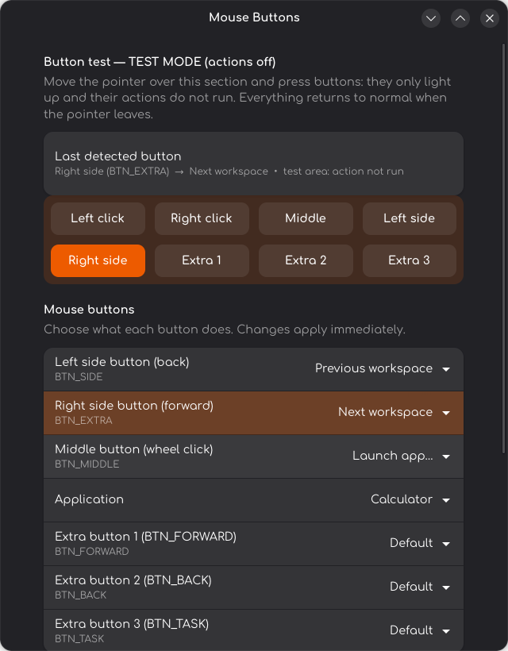

# Mouse Buttons

**[Türkçe](README.tr.md)**

Assign actions to your mouse buttons on Linux (GNOME, Wayland). A simple alternative to *X-Mouse Button Control* from Windows: for example, switch between workspaces with the side buttons, launch apps or send keyboard shortcuts.



## Features

- Assign to any mouse button: previous/next **workspace**, **launch an app** (pick from a searchable list of installed apps), send a custom **shortcut**, run a **command**, back/forward, copy/paste, disable the button, and more.
- **Live button test:** press a mouse button and the matching tile lights up in the window, showing which button it is and what it will do. While the pointer is over that section, buttons only light up and **their actions do not run**, so you can identify buttons safely.
- Changes are saved instantly; the background service starts automatically at every login.
- **English and Turkish interface**, chosen from your system language; switch it any time in the app (*Language / Dil*).
- Works on Wayland (no X11 required); no command-line knowledge needed to use it.
- Recovers on its own if the mouse is unplugged and plugged back in (wireless receiver, USB hub, KVM switch, etc.).

## Installation

### From source (any distribution)

**1. Install the dependencies** (Python 3, `python3-evdev`, GTK 4, libadwaita):

```bash
# Fedora
sudo dnf install git python3-evdev python3-gobject gtk4 libadwaita

# Debian / Ubuntu (untested)
sudo apt install git python3-evdev python3-gi gir1.2-gtk-4.0 gir1.2-adw-1

# Arch (untested)
sudo pacman -S git python-evdev python-gobject gtk4 libadwaita
```

**2. Download and install:**

```bash
git clone https://github.com/Snemege/mouse-buttons.git
cd mouse-buttons
./install.sh
```

The installer puts everything in your user folder and asks for your password only once, for the **mouse access rule** (explained below). Then open **Mouse Buttons** from your application menu.

**Update:**

```bash
cd mouse-buttons
git pull
./install.sh
```

### Fedora package

A Fedora package (COPR) is being prepared. Until then, use the steps above.

## Usage

1. Open the app and pick a button (e.g. *Left side button*).
2. Pick an action (e.g. *Previous workspace*).
3. Done. There is no save button.

Not sure which button is which? Move the pointer over the **Button test** section and press it on the mouse; the matching tile lights up and nothing else happens.

## Security and privacy

- The program reads **mouse** devices only, never the keyboard, and sends nothing over the network.
- To read the mouse, the rule `/etc/udev/rules.d/70-mouse-buttons.rules` is installed. It gives the logged-in user read access to mouse devices (`uaccess`), and access to `/dev/uinput` for sending key presses.
- While running it "grabs" the mouse and forwards every event unchanged to a virtual mouse; only buttons you assigned are intercepted. **If the service stops or crashes, the mouse returns to normal immediately.**
- Emergency stop: `systemctl --user stop mouse-buttons`

## Known limitations

- Tested so far only on **Fedora (GNOME, Wayland)**, with a 2.4 GHz wireless mouse, a wired Dell MS116 and a wired OEM gaming mouse. Please report problems with other mice or distributions.
- Workspace actions read GNOME's shortcut settings. Outside GNOME, use *Custom shortcut* instead.
- No per-application profiles; one configuration applies to all mice.
- With a **KVM switch or USB hub** the mouse disappears from this computer whenever you switch away and reappears when you switch back. The service handles this on its own and grabs the mouse again within a few seconds.
- Extra buttons that this list does not know (some gaming mice) show up as *Unrecognised button* in the test area, with a code number. Please open an issue with that number.

## Troubleshooting

| Problem | What to do |
|---|---|
| Buttons do nothing | Check the *Status* section in the window. If the service is not running: `systemctl --user restart mouse-buttons` |
| "None — no mouse connected, or no access permission" | Run `./install.sh` again; if that doesn't help, log out and back in. |
| To see the log | `journalctl --user -u mouse-buttons -o cat` |
| A button shows as "Unrecognised button" | Please open an issue with the code number shown in the window. |

## Uninstall

```bash
./uninstall.sh          # keeps your settings
./uninstall.sh --purge  # also deletes your settings
```

## How it works

A background service (`mouse_buttons.py --servis`) reads mouse devices through `evdev`, intercepts the assigned buttons and sends a virtual keyboard shortcut through `uinput`; every other event is forwarded to a virtual mouse. The settings window (GTK 4 / libadwaita) writes `~/.config/mouse-buttons/config.json`, which the service reloads immediately.

## Contributing and contact

Bug reports, ideas and pull requests are welcome: please open an issue at <https://github.com/Snemege/mouse-buttons/issues>. The developer's contact details are also available inside the app, under *Developer*.

## License

GPL-3.0-or-later. See [LICENSE](LICENSE).
