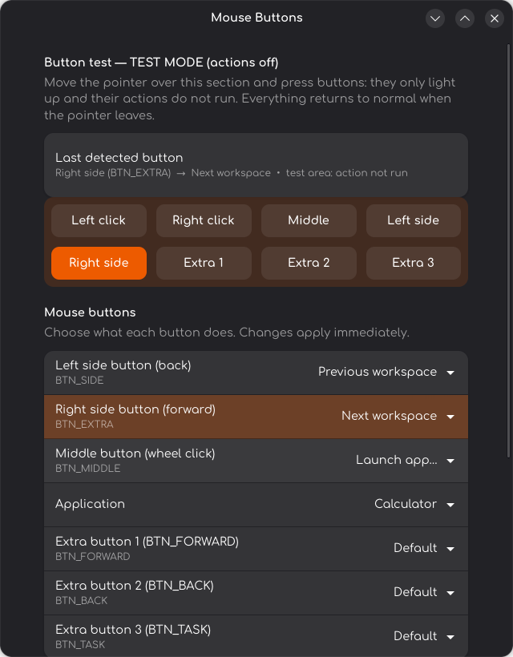

# Mouse Buttons (Fare Tuşları)

**[English](README.md)**

Linux'ta (GNOME, Wayland) mouse tuşlarına istediğiniz işi atayın. Windows'taki *X-Mouse Button Control*'ün sade bir karşılığı: örneğin yan tuşlarla sanal masaüstleri arasında geçin, uygulama açın, kısayol gönderin.



## Özellikler

- Mouse tuşlarına şu işleri atayın: önceki/sonraki **sanal masaüstü**, **uygulama aç** (kurulu uygulamalar arasından arayarak seçin), özel **kısayol** gönderme, **komut** çalıştırma, geri/ileri, kopyala/yapıştır, oynat/duraklat, **ses açma/kısma/kapatma** (ör. tekerlekte), tuşu devre dışı bırakma ve daha fazlası.
- **Canlı tuş testi:** Mouse'a bastığınızda pencerede ilgili tuş renkle yanar; hangi tuşun hangi koda karşılık geldiğini ve ne yapacağını görürsünüz. İmleç bu bölümün üzerindeyken tuşlar yalnızca renkle yanar, **eylemler çalışmaz**; böylece tuşları güvenle tanıyabilirsiniz.
- Ayarlar anında kaydolur; arka plan servisi her oturum açışta kendiliğinden başlar.
- **Türkçe ve İngilizce arayüz:** sistem dilinize göre seçilir, uygulamadan istediğiniz zaman değiştirebilirsiniz (*Language / Dil*).
- Wayland'de çalışır (X11'e bağlı değildir); kullanmak için komut satırı bilgisi gerekmez.
- Mouse çıkarılıp takılırsa (kablosuz alıcı, USB hub, KVM anahtarı vb.) kendiliğinden toparlanır.

## Kurulum

### Kaynaktan (tüm dağıtımlar)

**1. Gerekli paketleri kurun** (Python 3, `python3-evdev`, GTK 4, libadwaita):

```bash
# Fedora
sudo dnf install git python3-evdev python3-gobject gtk4 libadwaita

# Debian / Ubuntu (denenmedi)
sudo apt install git python3-evdev python3-gi gir1.2-gtk-4.0 gir1.2-adw-1

# Arch (denenmedi)
sudo pacman -S git python-evdev python-gobject gtk4 libadwaita
```

**2. İndirip kurun:**

```bash
git clone https://github.com/Snemege/mouse-buttons.git
cd mouse-buttons
./install.sh
```

Kurulum betiği her şeyi kullanıcı klasörünüze kurar ve yalnızca bir kez, **mouse okuma izni kuralı** için yönetici şifrenizi ister (aşağıda açıklanıyor). Sonra uygulama menüsünden **Mouse Buttons** uygulamasını açın (Türkçe sistemlerde adı "Fare Tuşları" görünür).

**Güncelleme:**

```bash
cd mouse-buttons
git pull
./install.sh
```

### Fedora paketi

Fedora paketi (COPR) hazırlanıyor. O zamana kadar yukarıdaki adımları kullanın.

## Kullanım

1. Uygulamayı açın, bir tuş seçin (ör. *Sol yan tuş*).
2. Eylemi seçin (ör. *Önceki sanal masaüstü*).
3. Bitti. Kaydet düğmesi yoktur.

Hangi tuşun hangisi olduğunu bilmiyorsanız imleci **Tuş testi** bölümünün üzerine getirip tuşa basın; ilgili kutucuk yanar, başka hiçbir şey olmaz.

## Güvenlik ve gizlilik

- Program yalnızca **fare** cihazlarını okur; klavyeyi okumaz. İnternete hiçbir şey göndermez.
- Mouse'u okuyabilmesi için `/etc/udev/rules.d/70-mouse-buttons.rules` kuralı kurulur. Bu kural, giriş yapmış kullanıcıya fare cihazları için okuma izni (`uaccess`) ve tuş göndermek için `/dev/uinput` erişimi verir.
- Çalışırken mouse'u "tutar" ve olayları sanal bir fareye aynen aktarır; yalnızca atadığınız tuşları yakalar. **Servis durursa ya da çökerse mouse hemen normale döner.**
- Acil durum: `systemctl --user stop mouse-buttons`

## Bilinen sınırlar

- Şimdilik yalnızca **Fedora (GNOME, Wayland)** üzerinde, 2,4 GHz kablosuz bir mouse, kablolu bir Dell MS116 ve kablolu bir OEM oyuncu mouse'u ile denendi. Başka mouse ve dağıtımlarda sorun görürseniz lütfen bildirin.
- Sanal masaüstü eylemleri GNOME'un kısayol ayarlarını okur. GNOME dışında bu eylemler yerine *Özel kısayol* kullanın.
- Uygulamaya özel ayar (profil) yok; tüm fareler için tek ayar geçerlidir.
- **KVM anahtarı ya da USB hub** kullanıyorsanız, başka bilgisayara geçtiğinizde mouse bu bilgisayardan kaybolur, geri döndüğünüzde yeniden görünür. Servis bunu kendiliğinden halleder ve birkaç saniye içinde mouse'u tekrar yakalar.
- Bu listenin bilmediği ek tuşlar (bazı oyuncu mouse'ları) test alanında kod numarasıyla *Tanınmayan tuş* olarak görünür. Lütfen o numarayla bir *issue* açın.

## Sorun giderme

| Sorun | Ne yapmalı |
|---|---|
| Tuşlar çalışmıyor | Pencerede *Durum* bölümüne bakın. Servis çalışmıyorsa: `systemctl --user restart mouse-buttons` |
| "Yok — mouse bağlı değil ya da erişim izni verilmemiş" | `./install.sh`'ı yeniden çalıştırın; olmazsa oturumu kapatıp açın. |
| Günlüğü görmek için | `journalctl --user -u mouse-buttons -o cat` |
| Bir tuş "Tanınmayan tuş" olarak görünüyor | Pencerede görünen kod numarasını bir *issue* olarak bildirin. |

## Kaldırma

```bash
./uninstall.sh          # ayarlarınız kalır
./uninstall.sh --purge  # ayarlar da silinir
```

## Nasıl çalışır?

Bir arka plan servisi (`mouse_buttons.py --servis`) fare cihazlarını `evdev` ile okur, atanmış tuşları yakalar ve `uinput` üzerinden sanal klavye kısayolu gönderir; diğer tüm olayları sanal bir fareye aktarır. Ayar penceresi (GTK 4 / libadwaita) `~/.config/mouse-buttons/config.json` dosyasını yazar, servis değişikliği anında yükler.

## Katkı ve iletişim

Hata bildirimleri, fikirler ve katkılar (pull request) memnuniyetle karşılanır: lütfen <https://github.com/Snemege/mouse-buttons/issues> adresinde bir *issue* açın. Geliştiricinin iletişim bilgileri uygulamanın içinde, *Geliştirici* satırında da bulunur.

## Lisans

GPL-3.0-or-later. Ayrıntılar için [LICENSE](LICENSE) dosyasına bakın.
